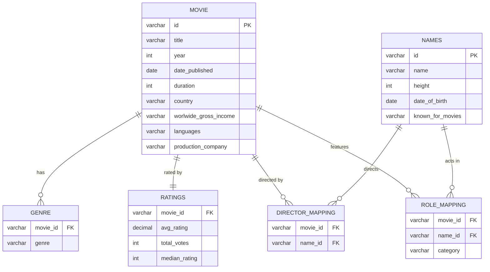

# 🎬 IMDb Movie Analysis for RSVP Movies


An end-to-end SQL analysis of an IMDb dataset (2017–2019) to help **RSVP Movies**, an Indian film production company, plan its next global release: which genre to make, when to release it, and which directors, actors and production partners to work with.

---

## 📌 Business Problem

RSVP Movies has produced many hits for Indian audiences and now wants to release a film for a worldwide audience. Using data on ~8,000 movies released between 2017 and 2019, this project answers 29 business questions to guide that decision.

## 🗂️ Dataset & Schema

Six related tables, linked through movie and person IDs:



## 🔍 Analysis Structure

| Segment | Focus | Questions |
|---|---|---|
| 1. Data Exploration | Table shapes, NULL checks, release trends by year and month, genre counts | Q1 – Q9 |
| 2. Ratings Analysis | Rating ranges, top-rated movies, hit-producing studios, country comparisons | Q10 – Q17 |
| 3. People | Top directors, actors and actresses; weighted ratings for Indian talent | Q18 – Q24 |
| 4. Advanced Analysis | Running totals, moving averages, top grossers, director profiles | Q25 – Q29 |

All queries are in [`sql/imdb_analysis.sql`](sql/imdb_analysis.sql), each labelled by question number.

## 🛠️ SQL Techniques Used

- **Multi-table joins** across six tables
- **Common Table Expressions (CTEs)** to break complex logic into readable steps
- **Window functions**: `RANK()`, `DENSE_RANK()`, `ROW_NUMBER()`, `LEAD()`, running `SUM()` and moving `AVG()` with custom frames
- **Vote-weighted averages** so heavily voted movies count more than obscure ones
- **Conditional logic** with `CASE` to classify movies (Superhit / Hit / One-time-watch / Flop)
- **Data cleaning in SQL**: parsing currency text into numbers, handling multi-value columns (countries, languages), excluding NULLs
- **Date functions**: `MONTH()`, `DATEDIFF()` for gaps between a director's releases

## 💡 Key Insights

| Area | Finding |
|---|---|
| Genre | **Drama** is the most produced genre, with an average runtime of **106.77 minutes**. Thriller ranks 3rd. |
| Timing | **March** has the highest number of releases. |
| Genre overlap | Over 3,000 movies belong to a single genre, so most films are not multi-genre. |
| Ratings | A median rating of **7** is the most common. |
| Production partners | **Marvel Studios** draws the most audience votes; **Dream Warrior Pictures** and **National Theatre Live** produced the most hits (avg rating > 8). |
| Multilingual hits | **Star Cinema** and **Twentieth Century Fox** lead in highly rated multilingual movies. |
| Directors | **James Mangold** leads among directors in the top genres. |
| Indian talent | **Vijay Sethupathi** is the top-rated Indian actor; **Taapsee Pannu** is the top Hindi actress (weighted rating 7.74). |

## ✅ Recommendations for RSVP Movies

1. **Make a Drama.** It's the most produced genre with proven audience appeal; target a runtime of about 105–110 minutes.
2. **Release in March.** It's historically the busiest release month.
3. **Partner with high-visibility studios** such as Marvel Studios or Twentieth Century Fox for global reach.
4. **Cast proven regional talent** (e.g. Vijay Sethupathi, Taapsee Pannu) to win the home audience alongside a global one.

The full write-up is in [`reports/executive_summary.pdf`](reports/executive_summary.pdf).

## 📁 Repository Structure

```
imdb-sql-analysis/
├── README.md
├── sql/
│   └── imdb_analysis.sql        # All 29 queries, grouped by segment
├── reports/
│   └── executive_summary.pdf    # Findings and recommendations
└── images/                      # Screenshots of query outputs
```

## ▶️ How to Run

1. Install **MySQL 8.0+** (window functions and CTEs are required) and a client such as MySQL Workbench.
2. Create the `imdb` database and load the six tables.
3. Open `sql/imdb_analysis.sql` and run queries one at a time, or the whole script.

## 🙏 Acknowledgements

Case study and dataset provided as part of a data analytics program. The dataset is used for educational purposes.

## 👤 Author

**Mohammed Asad Khan** · [LinkedIn](https://www.linkedin.com/in/mo-asad-kh) · [GitHub](https://github.com/Aasxd)
